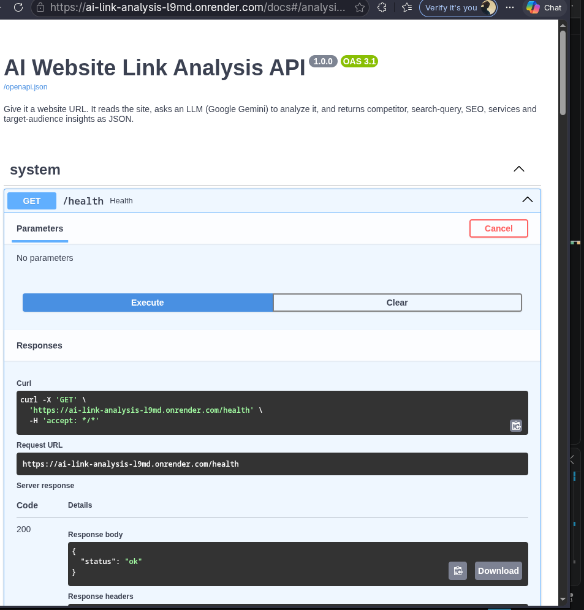
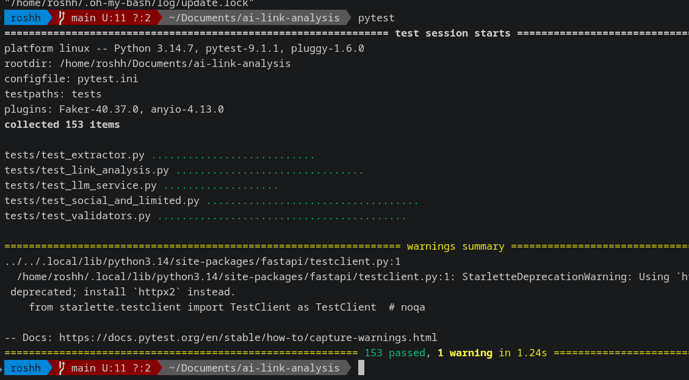

# AI Website Link Analysis API

**Live demo:** https://ai-link-analysis-l9md.onrender.com/docs  
*(Hosted on Render's free plan, so the first request after a quiet period can take about a minute.)*

Give it a website URL. It reads the site, asks an LLM (Google Gemini) to understand it, and returns a structured JSON analysis with five sections:

1. **Competitor vs. your brand** (overview, competitors, strengths, gaps, positioning opportunities, comparison table)
2. **Top 5 target search queries** (for Google, Facebook, Instagram, LinkedIn and X)
3. **SEO improvements** (keywords, title, meta description, supporting content ideas)
4. **Top 5 services** (labelled as found on the website or inferred)
5. **Target audience** (primary/secondary, industries, needs, segments)

Built with **Python 3, FastAPI, Pydantic, httpx and BeautifulSoup**.

---

## Quick start

```bash
# 1. Create a virtual environment and install dependencies
python -m venv .venv
source .venv/bin/activate          # Windows: .venv\Scripts\activate
pip install -r requirements.txt

# 2. Add your free Gemini key (get one at https://aistudio.google.com/apikey)
cp .env.example .env               # Windows: copy .env.example .env
# then open .env and paste your key after GEMINI_API_KEY=

# 3. Run the server on port 4000
uvicorn app.main:app --host 0.0.0.0 --port 4000
```

Interactive API docs: <http://localhost:4000/docs>

### Try it

```bash
curl -X POST http://localhost:4000/link-analysis \
  -H "Content-Type: application/json" \
  -d '{"url": "https://www.python.org"}'
```

Or against the live demo:

```bash
curl -X POST https://ai-link-analysis-l9md.onrender.com/link-analysis \
  -H "Content-Type: application/json" \
  -d '{"url": "https://www.python.org"}'
```

A request can take roughly 5–20 seconds, because the app fetches the site and then waits for the LLM. Repeating the same URL is instant (it is cached for an hour).

### Run the tests

```bash
pytest
```

The tests never call the real internet or the real Gemini API, so they are fast and free. They use a fake network, fake DNS and a fake LLM.

### Try many links at once

`scripts/smoke_test.py` sends about 45 different links to a running copy of the API (ordinary sites, social profiles, the same site typed different ways, and links that must be rejected) and checks each result against what should happen:

```bash
python scripts/smoke_test.py                                          # local server
python scripts/smoke_test.py --base-url https://ai-link-analysis-l9md.onrender.com   # live demo
python scripts/smoke_test.py --only social                            # one group
```

Results for live sites depend on those sites and on the AI provider, so a failed case means "look at this one".

---

## Response format

> The example below is an **abridged format example**; the full one is in [`docs/sample_response_format_example.json`](docs/sample_response_format_example.json). It was generated from test data, **not** from a live model call. Real captured responses are saved in `docs/samples/` (see the LLM research section).

```jsonc
{
  "success": true,
  "website": "https://acme.example/",
  "brand": { "name": "Acme Web Studio", "category": "Web Development Agency", "summary": "..." },
  "analysis": {
    "competitor_analysis": {
      "brand_overview": "...",
      "main_category": "Web Development",
      "main_products_services": ["..."],
      "your_brand_profile": { "main_service": "...", "target_market": "...", "key_strength": "...", "opportunity": "..." },
      "competitors": [
        { "name": "Wix", "website": "https://www.wix.com", "main_service": "...", "target_market": "...",
          "strengths": ["..."], "weaknesses": ["..."], "source": "ai_suggested" }
      ],
      "comparison_table": [
        { "aspect": "Main Service", "your_brand": "Website development", "competitors": { "Wix": "Website builder" } }
      ],
      "strengths": ["..."],        // your brand's competitive advantages
      "opportunities": ["..."]     // ways to improve market positioning
    },
    "target_search_queries": [
      { "query": "affordable web design for small business", "platforms": ["Google", "Facebook"],
        "intent": "Service Search", "business_relevance": "...", "target_audience": "..." }
    ],
    "seo_improvements": {
      "primary_keyword": "...", "secondary_keywords": [], "long_tail_keywords": [], "business_keywords": [],
      "recommended_title": "...", "title_structure": "...", "meta_description": "...",
      "supporting_content": [{ "type": "FAQ", "title": "...", "reason": "..." }],
      "title_length": 46, "meta_description_length": 88
    },
    "top_services": [
      { "name": "...", "description": "...", "target_industry": "...", "target_customer": "...",
        "main_benefit": "...", "source": "website" }
    ],
    "target_audience": {
      "primary_audience": [], "secondary_audience": [], "industries": [], "business_types": [],
      "customer_profiles": [], "geographic_focus": [], "customer_needs": [],
      "customer_interests": [], "recommended_segments": []
    }
  },
  "meta": {
    "model_used": "gemini-3.5-flash-lite", "cached": false, "elapsed_ms": 9140,
    "content_source": "page",           // or "url_only" when the page could not be read
    "platform": null, "account": null,  // e.g. "Instagram" / "crestspot" for social links
    "grounded": false, "grounding_sources": [],
    "pages_analyzed": ["https://acme.example/", "https://acme.example/about"],
    "prompt_tokens": 3120, "output_tokens": 2240,
    "warnings": [],
    "notes": ["Competitors are AI-generated suggestions, not live market research.",
              "No search-volume or ranking data is included because none was measured."]
  }
}
```

### Errors

Every error uses the same shape:

```json
{ "success": false, "error": { "code": "blocked_url", "message": "..." } }
```

| HTTP | `code` | When |
|---|---|---|
| 422 | `invalid_request` | Body is not JSON like `{"url": "..."}` |
| 422 | `invalid_url` | Not a valid http(s) URL |
| 400 | `blocked_url` | URL points to a private/internal address (SSRF protection) |
| 422 | `unsupported_content` | URL is not an HTML page (PDF, image, ...) |
| 502 | `website_unreachable` | Unknown domain, timeout, or a real HTTP 404/5xx. (Pages that refuse automated access, or have no readable text, do **not** error. See "Social media links and blocked pages".) |
| 502 | `llm_error` / `llm_invalid_output` | The AI provider failed or returned unusable output |
| 503 | `llm_rate_limited` | Gemini free-tier limit hit even after retries |
| 429 | `rate_limited` | Too many requests from one client (`Retry-After` header included) |
| 500 | `llm_not_configured` / `internal_error` | Missing/invalid API key, or an unexpected bug (details are never leaked) |

---

## How it works

```
POST /link-analysis
   │
   ├─ 1. normalize + validate URL ........ utils/validators.py   (SSRF checks)
   ├─ 2. cache lookup .................... utils/cache.py        (1-hour TTL)
   ├─ 3. fetch home page + About/Services  services/website_extractor.py
   ├─ 4. clean text, headings, JSON-LD ... (scripts/nav/footers removed, duplicates dropped, size capped)
   ├─ 5. ONE LLM call for all 5 sections . services/llm_service.py + prompts.py
   ├─ 6. validate the JSON (Pydantic) .... one corrective retry if something is missing
   ├─ 7. tidy competitors + SEO .......... services/competitor_service.py
   └─ 8. structured JSON response
```

### Project structure

```
app/
  main.py                      FastAPI app, routes, error handlers
  config.py                    settings from environment variables
  schemas.py                   request / response / LLM-output models
  exceptions.py                every error the API returns on purpose
  services/
    website_extractor.py       safe fetching + HTML cleaning
    llm_service.py             Gemini client: retries, fallback model, JSON parsing
    prompts.py                 the instructions sent to the model
    analysis_service.py        the pipeline conductor
    competitor_service.py      competitor cleanup + comparison table
  utils/
    validators.py              URL validation and SSRF protection
    cache.py                   TTL cache
    rate_limit.py              per-client rate limiter
tests/                         191 tests (validators, extractor, LLM client, pipeline, API)
scripts/benchmark.py           measures real latency/tokens/reliability of models
scripts/smoke_test.py          runs ~45 varied links against a running API and checks each result
```

### Design decisions

- **One LLM call for all five sections.** Cheaper and faster than five calls, and the sections stay consistent with each other.
- **Plain HTTPS to Gemini instead of an SDK.** Fewer dependencies and easy to test with a fake network.
- **Honest about what the model can't know.** Competitors are labelled `ai_suggested`, services are labelled `website` or `inferred`, and no search volumes are ever invented.
- **Prompt-injection resistance.** Website text is wrapped in markers and declared untrusted data; the model is told to ignore instructions inside it.
- **Forgiving but strict.** The schema fixes small slips (e.g. "Twitter" becomes "X", a string where a list was expected). If something important is missing (say, only 3 of the 5 queries), the model is told exactly what was wrong and gets one retry. If the answer is still incomplete but useful, it is returned as a partial result with a clear warning in `meta.warnings` instead of an error; nothing is invented to fill the gaps.
- **Quota protection.** Per-IP rate limiting, a response cache, and retries with backoff for Gemini's free-tier limits.

### Social media links and blocked pages

Instagram, X, Facebook, LinkedIn and similar platforms refuse automated page reads (login walls, HTTP 429/403, bot detection), and some normal sites do too. A hard error is the wrong answer for a valid public link, so the API handles it like this:

1. It recognizes the platform and account name from the URL (`app/utils/social.py`).
2. If the page cannot be read (the site refuses automated visitors with HTTP 401/403/429/999 or any other 4xx except 404/410, redirects in a loop, shows a login page, or has almost no text; for social links also timeouts and HTTP 5xx), it still returns **HTTP 200** with an analysis of the account *behind the link*, in **link-only mode**.
3. In link-only mode the model is asked to look the account up with **Google Search grounding**. If that tool is unavailable, it falls back to the model's general knowledge and says so.
4. The response is clearly labelled so nobody mistakes it for a page-based analysis: `meta.content_source` is `"url_only"`, `meta.warnings` explains why, `meta.platform` and `meta.account` are filled in, and every service is marked `"inferred"`. Link-only results are not cached.

What this does **not** do: it does not bypass logins or bot protection, and it does not pretend to have read a page it could not read. For a small or obscure account the model may not be able to identify the business. Then it is told to say so and keep the answer generic rather than invent details. Genuine problems (invalid or private URLs, unknown domains, HTTP 404, non-HTML files, AI provider failures) still return clear errors.

### Security

- **SSRF protection** (`utils/validators.py`): only http/https; ports limited to 80, 443, 8080, 8443; no embedded credentials; blocks `localhost`, `.local`/`.internal` names, and any hostname that *resolves* to a private, loopback, link-local, CGNAT or reserved address (IPv4 and IPv6, including IPv4-mapped IPv6). The check is repeated on **every redirect hop**.
- **Download limits:** 12-second timeout, 2 MB response cap, HTML-only content types.
- **Secrets:** the API key comes from the environment, is sent in a header (never in a URL), and is never logged. `.env` is git-ignored; only `.env.example` is committed.
- **Errors never leak internals:** unexpected exceptions return a generic message and are logged server-side.

### Known limitations (being upfront)

- **JavaScript-rendered sites** (pure React/Vue single-page apps) return little HTML text. The API detects this and switches to link-only mode (see above) instead of guessing from empty content. A headless browser (e.g. Playwright) would read these pages properly but is slower and heavier.
- **Bot-blocking sites and social platforms** refuse automated reads. The API then returns a clearly labelled link-only analysis, which is lower confidence than a page-based one. The Google Search grounding used there depends on the Gemini model and plan supporting it, and on free-tier quota; if it is unavailable the answer relies on general model knowledge only.
- **DNS rebinding:** we validate the resolved IPs before connecting, but a hostile DNS server could change its answer between the check and the connection. Closing this completely needs IP pinning at the socket level.
- **Competitors are suggestions from the model's general knowledge**, not live market research. They are labelled that way in every response.
- **In-memory cache and rate limiter** work for a single server process. Multiple instances would need Redis.

---

## LLM platform and model research

> **How to read this section:** prices are from the sources linked below (checked 18 Nov 2026). Token counts and response times come from **real runs** of this API (see "Measured results"). Costs are **calculated** from list prices and those measured token counts. Accuracy was checked by reading the outputs, not by a formal benchmark, and I make no claim of "maximum accuracy".

### A. Platform comparison

| Provider | Model | API price per 1M tokens (input / output) | Context window | JSON support | Free tier |
|---|---|---|---|---|---|
| Google | **Gemini 3.5 Flash-Lite** | $0.30 / $2.50 | 1M tokens | Yes (JSON mode / structured output) | **Yes** |
| Google | Gemini 3.1 Flash-Lite | $0.25 / $1.50 | 1M tokens | Yes | **Yes** |
| Anthropic | Claude Haiku 5.5 | $0.10 / $0.50 (prompts up to 100K tokens; 5x higher above that) | Not verified in this research | Not verified in this research | No |
| OpenAI | GPT-6 Luna | $0.10 / $0.50 | 1,050,000 tokens | Yes (JSON-schema structured outputs) | No |

Speed and accuracy are deliberately **not** filled in from marketing claims. Gemini 3.5 Flash-Lite was measured (see "Measured results"); the other models were compared on list price and documented features only and were **not** run.

**Sources:** [Anthropic pricing](https://platform.claude.com/docs/en/about-claude/pricing?m=1) · [OpenAI GPT-6 Luna model page](https://developers.openai.com/docs/models/gpt-6-luna) · Gemini prices from [Google's pricing page](https://aistudio.google.com/docs/pricing) and cross-checked against third-party trackers ([geotoolbox.ai](https://geotoolbox.ai/blog/gemini-api-pricing), [benchlm.ai](https://benchlm.ai/google/api-pricing), [fastero.com](https://fastero.com/blog/gemini-api-pricing)). Gemini prices and free-tier limits change often, so confirm on Google's page before quoting. Gemini free-tier per-model rate limits are only shown inside Google AI Studio.

### B. Model selection

| Criterion | Assessment |
|---|---|
| Cost | Gemini's free tier makes this test **$0** to run; paid list prices are all under a cent per analysis |
| Structured JSON | Gemini JSON mode plus Pydantic validation plus one corrective retry (built and tested) |
| Large pages | 1M-token context is far more than the ~5K tokens we send, so context is never the limit |
| Speed | Measured: about 16-20 s end to end per fresh analysis (includes fetching the site), acceptable for an on-demand analysis API |
| Accuracy | Brand, services and competitors matched the real companies on the 3 sites tested. Not a formal benchmark (see limits below) |

### C. Cost optimization (all implemented)

- **Clean before sending:** scripts, styles, nav, footers, forms and SVG are removed; duplicate lines are dropped; the page text is capped (~14,000 characters total), so we send about 3K tokens of site content instead of tens of thousands of raw HTML.
- **Short, structured prompt:** one fixed template (~1,200 tokens), no filler.
- **One call, not five:** the instructions and website text are paid for once.
- **Small model for the job:** extraction and structured analysis don't need a frontier model, so we use a Flash-Lite tier model.
- **Cache:** the same URL within an hour costs nothing (`CACHE_TTL_SECONDS`).
- **Retry only what's needed:** one corrective retry for incomplete output; no blind repeats.
- **Rate limiting:** stops abuse from burning quota.
- **Fallback model:** if the primary is overloaded or unavailable, `GEMINI_FALLBACK_MODEL` takes over.
- **Further savings if this went to production:** Batch API (50% cheaper) for non-interactive bulk jobs, and context caching for the repeated instruction block.

### D. Final recommendation

| Item | Value |
|---|---|
| Recommended provider | Google Gemini |
| Recommended model | `gemini-3.5-flash-lite` |
| Fallback model | `gemini-3.1-flash-lite` (cheaper paid output at $1.50/M; switched to automatically) |
| Input tokens | **Measured:** 3,844 to 4,628, average about 4,230 per analysis (3 sites) |
| Output tokens | **Measured:** 2,351 to 2,512, average about 2,460 (3 sites) |
| Cost per analysis | **$0 on the free tier.** Paid tier, **calculated** from the measured tokens at $0.30 / $2.50 per 1M: about $0.0074 per analysis, about $7.40 per 1,000 |
| Response time | **Measured:** 15.6 s and 19.8 s end to end for two fresh runs (one run each, includes fetching the site and the LLM call). Repeat requests are served from cache in about 0 ms |

**Why this model:** the free tier fits this project and its demo, the price is already tiny, the 1M-token context removes any size worry, and structured JSON output is supported.

**Honest trade-off:** on paid list prices, Claude Haiku 5.5 and GPT-6 Luna come out about 4.5x cheaper per analysis (~$0.002). I have **not** tested their accuracy on this task. If cost at scale mattered more than the free tier, the next step would be to benchmark them against Gemini on the same websites. Only `llm_service.py` would need to change.

**Balancing accuracy, speed and cost:** start with the Flash-Lite model, validate every answer, retry once with feedback, fall back to the second model, and only move up to a larger model (e.g. a Flash or Pro tier) if the benchmark shows quality problems on real sites.

### Measured results

Real runs of this API with `gemini-3.5-flash-lite` on 18 Nov 2026, through the `/link-analysis` endpoint. Token counts and times are the values the API itself reports in `meta`. Full responses are saved in [`docs/samples/`](docs/samples/).

| Website | End-to-end time | Input tokens | Output tokens | Result | Paid-tier cost (calculated) |
|---|---|---|---|---|---|
| notion.so | 19.8 s | 3,844 | 2,512 | Valid, all 5 sections | $0.0074 |
| shopify.com | 15.6 s | 4,628 | 2,510 | Valid, all 5 sections (warning: SEO title was 66 characters, over the 60 target) | $0.0077 |
| python.org | not timed (see below) | 4,215 | 2,351 | Valid, all 5 sections | $0.0071 |
| docmind.space | n/a | n/a | n/a | Error at the time (the site is rendered by JavaScript). This run was **before** link-only mode was added and has not been re-measured | n/a |
| **Average (valid runs)** | **17.7 s** (2 timed runs) | **4,229** | **2,458** | 3 of 3 valid sites passed | **$0.0074** (about $7.40 per 1,000) |

What these numbers do and don't show:

- **One run per site, one model.** This is a small sample, not a statistical benchmark. Times will vary with site size, network and Gemini load.
- **python.org was not timed:** the saved response was a cache hit from an earlier identical request, so its `elapsed_ms` is 0. Its token counts are from the original model call.
- **Times are end to end** (fetching up to 3 pages, then the LLM call), not LLM time alone.
- **Whether the app had to use its corrective retry** is not recorded in the response, so "valid" means the final result passed validation.
- **Accuracy** was judged by reading the outputs: brand names, categories, services and competitors matched the real companies, and services pulled from the pages were labelled `website`. Competitors are AI suggestions and were not independently verified.
- **Weak spot found and fixed:** on the Shopify run the extractor spent one of its three page reads on a Terms of Service page. Legal, privacy, login and cart pages are now excluded from page selection (covered by a test).
- **Known miss, since addressed:** `docmind.space` returned almost no text to a plain HTTP fetch, because the site is rendered in the browser by JavaScript. A live review run of an Instagram link also failed, with HTTP 429. Both cases now return a labelled link-only analysis (see "Social media links and blocked pages"). The new behaviour is covered by automated tests with simulated blocking; it has not been added to this measured table.

`scripts/benchmark.py` can repeat this across several models and sites if you want more data.

---

## Configuration

All settings are environment variables (see `.env.example`):

| Variable | Default | Meaning |
|---|---|---|
| `GEMINI_API_KEY` | (required) | Your Gemini key |
| `GEMINI_MODEL` | `gemini-3.5-flash-lite` | Primary model |
| `GEMINI_FALLBACK_MODEL` | `gemini-3.1-flash-lite` | Used if the primary fails or is unavailable |
| `LLM_TIMEOUT_SECONDS` / `LLM_MAX_RETRIES` | 60 / 2 | LLM call timeout and retries |
| `FETCH_TIMEOUT_SECONDS` | 12 | Website download timeout |
| `MAX_EXTRA_PAGES` | 2 | Extra About/Services pages to read |
| `MAX_CONTENT_CHARS` | 14000 | Max website text sent to the LLM |
| `CACHE_TTL_SECONDS` | 3600 | Result cache lifetime (0 disables) |
| `RATE_LIMIT_PER_MINUTE` | 30 | Per-IP limit (0 disables) |

If a call fails with "model not available", check the current model names in Google AI Studio and update `GEMINI_MODEL` in `.env`. No code change is needed.

## Deploying a demo (example: Render)

1. Push the repo to GitHub (public), making sure `.env` is **not** committed.
2. On Render: New → Web Service → connect the repo.
3. Build command: `pip install -r requirements.txt`
4. Start command: `uvicorn app.main:app --host 0.0.0.0 --port $PORT`
5. Add `GEMINI_API_KEY` as an environment variable in the Render dashboard.
6. Your demo link is `https://<your-service>.onrender.com/docs`.

## Screenshots

**Live demo: successful analysis (Render)**



**Tests passing**


